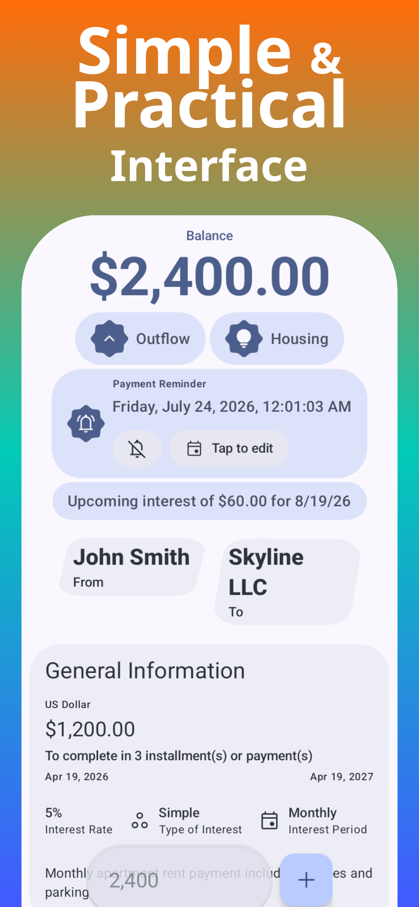
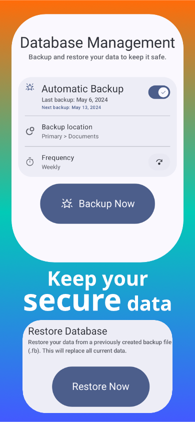
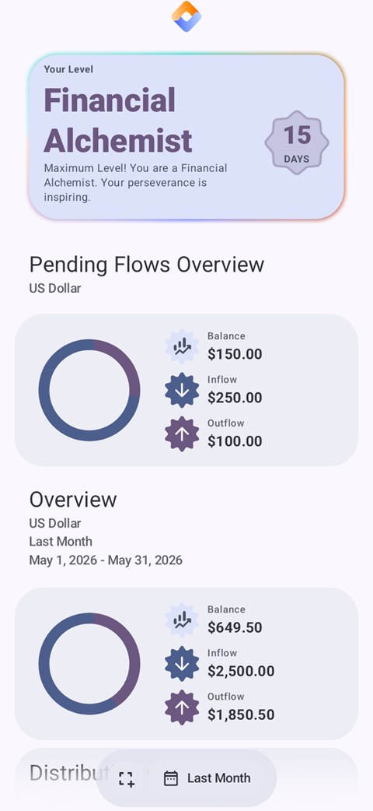
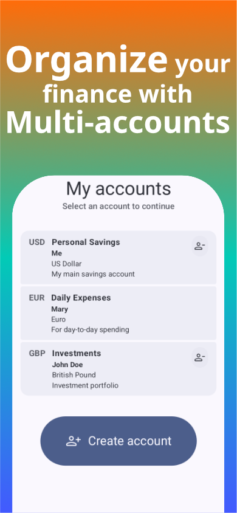
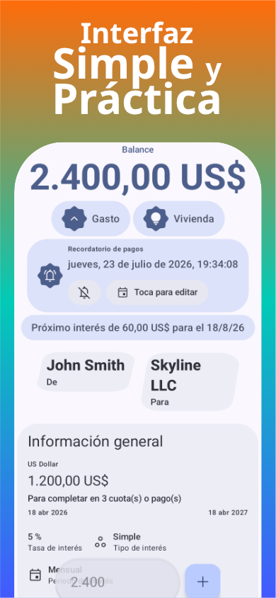
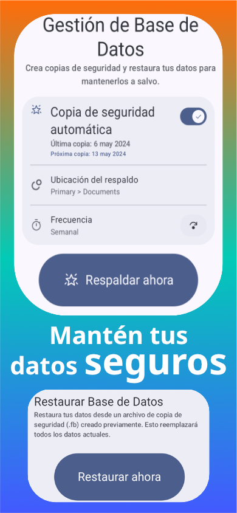
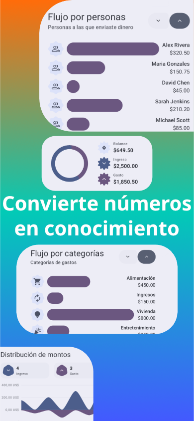

  

<h1 align="center">Flow Balance</h1>

## 🌐 Languages / Idiomas

* [English](#-english) — **Your Finance Manager, Simple and Private**
* [Español](#-español) — **Tu Gestor de Finanzas, Simple y Privado**
* Française — **Votre gestionnaire de finances, simple et privé**
* हिन्दी — **आपका वित्त प्रबंधक, सरल और निजी**

---

## 🇺🇸 English

Organize your income and expenses, recording every movement with a focus on simplicity and your privacy.
Flow Balance is the modern solution for managing your personal finances. Designed to be efficient, clear, and organized, it allows you to take complete control based on three pillars: **Offline Priority**, **Modern Interface**, and a strict **Commitment to Privacy**.

> ⚠ **Warning:** The app does not display currency conversion rates and does not perform currency exchanges. All records remain in the currency you choose.

| 1 | 2 | 3 | 4 |
| --- | --- | --- | --- |
|  |  |  |  |

---

### ✨ Flow Balance Installation Guide

Flow Balance is downloaded directly from its official source on GitHub (**Sideloading**). To avoid security risks, always download only from the official `zmr-software` link.

#### 1. Choose the Right Version for Your Device
* **arm64-v8a (Recommended):** For modern Android smartphones.
* **x86_64:** For modern Chromebooks.
* **other:** Compatible with virtually any Android phone.

#### 2. Installation Steps
1. **Visit the Official Site:** Go to the [GitHub Releases](https://github.com/zmr-software/FlowBalance/releases) page.
2. **Download the File:** Tap the appropriate `.apk` file `(Choose the Right Version for Your Device)` to start downloading.
3. **Authorize Installation:** If your system prompts a security warning regarding unknown sources, open Settings and toggle "Allow from this source".
4. **Install:** Return to the downloaded file, tap Install, and open the app to get started.

---

### 📬 Contact
**ZMR / Flow Balance** - Help us improve by reporting bugs!
* **Email:** helpZMR+flowbalance@proton.me
* *Please include: App Version, OS Version, and steps to reproduce the error.*

---

Private License software. All rights reserved. Distribution, modification, or usage is strictly restricted.

---
---

## 🇪🇸 Español

Organiza tus ingresos y egresos, registra cada movimiento con un enfoque en la simplicidad y tu privacidad.
Flow Balance es la solución moderna para la gestión de tus finanzas personales. Diseñada para ser eficiente, clara y organizada, te permite tomar el control total bajo tres pilares: **Prioridad Offline**, **Interfaz Moderna** y un firme **Compromiso con la Privacidad**.

> ⚠ **Advertencia:** La aplicación no muestra tasas de conversión de divisas ni realiza cambios de moneda. Todos los registros permanecen en la moneda que elijas.

| 1 | 2 | 3 | 4 |
| --- | --- | --- | --- |
|  |  |  |  |

---

### ✨ Guía de Instalación de Flow Balance

Flow Balance se descarga directamente desde su fuente oficial en GitHub mediante **Sideloading**. Para evitar riesgos de seguridad, descarga siempre exclusivamente desde el enlace oficial de `zmr-software`.

#### 1. Elige la Versión Correcta para tu Dispositivo
* **arm64-v8a (Recomendado):** Para smartphones Android modernos.
* **x86_64:** Para Chromebooks modernos.
* **otro:** Compatible con cualquier teléfono Android.

#### 2. Pasos para la instalación
1. **Entra a la web oficial:** Ve a la página de [Lanzamientos en GitHub](https://github.com/zmr-software/FlowBalance/releases).
2. **Descarga el Archivo:** Toca el archivo `.apk`, `(Elige la Versión Correcta para tu Dispositivo)` para comenzar la descarga.
3. **Autoriza la Instalación:** Si el sistema muestra un aviso de seguridad sobre fuentes desconocidas, ve a Ajustes y activa "Permitir desde esta fuente".
4. **Instala la Aplicación:** Regresa al archivo descargado, presiona Instalar y abre la aplicación para empezar.

---

### 📬 Contacto
**ZMR / Flow Balance** - ¡Ayúdanos a mejorar reportando fallos!
* **Correo:** helpZMR+flowbalance@proton.me
* *Por favor incluye: Versión de la App, Versión del Sistema Operativo y los pasos para reproducir el fallo.*

---

Software de Licencia Privada. Todos los derechos reservados. La distribución, modificación o uso están estrictamente restringidos.

